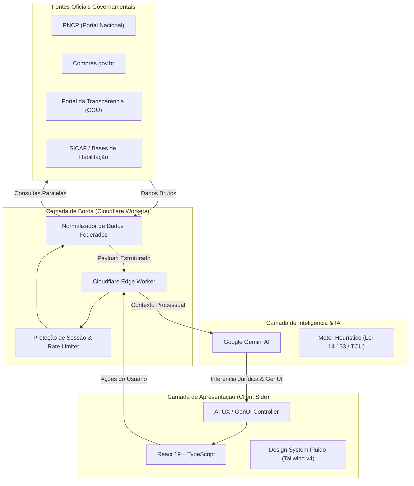
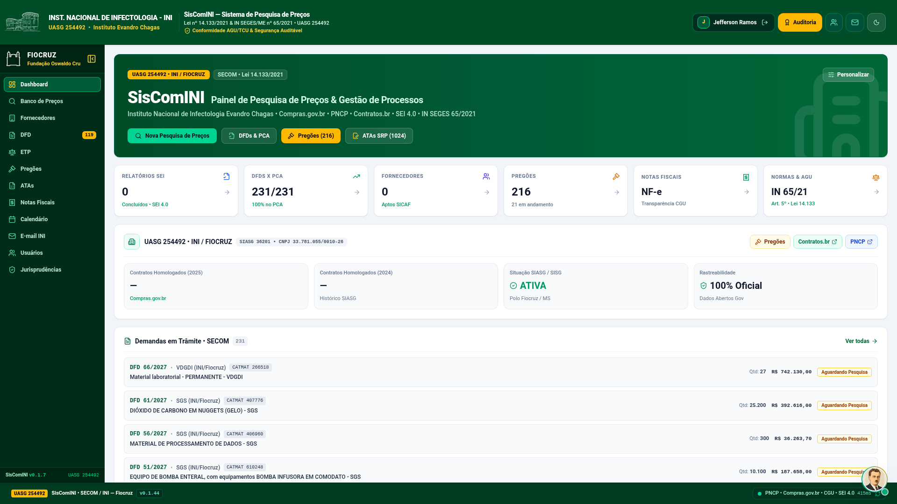
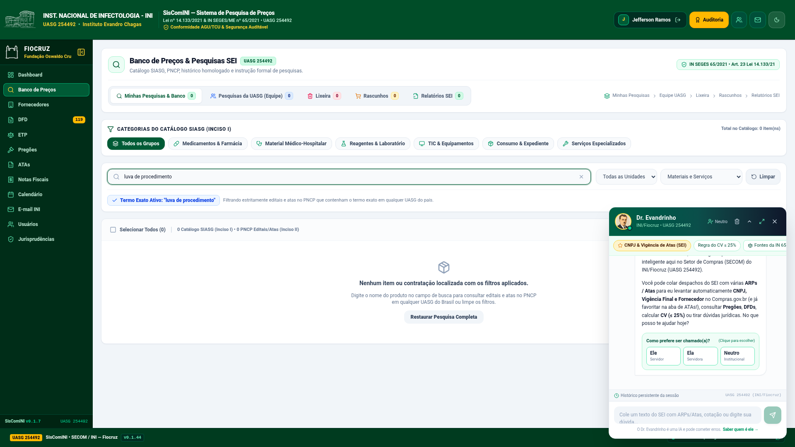
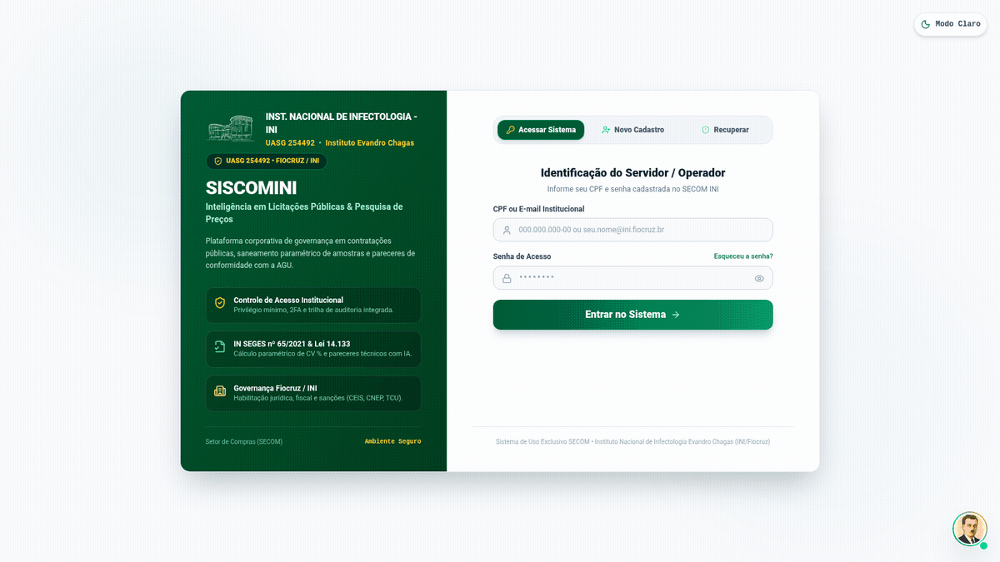
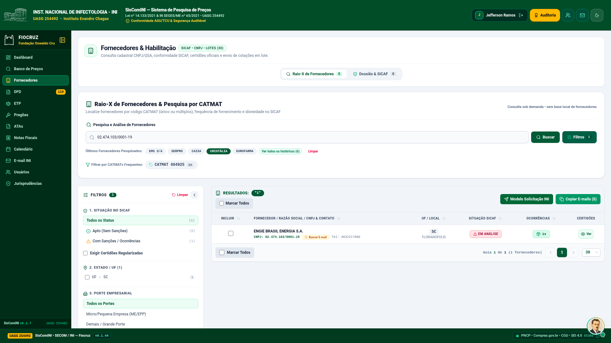
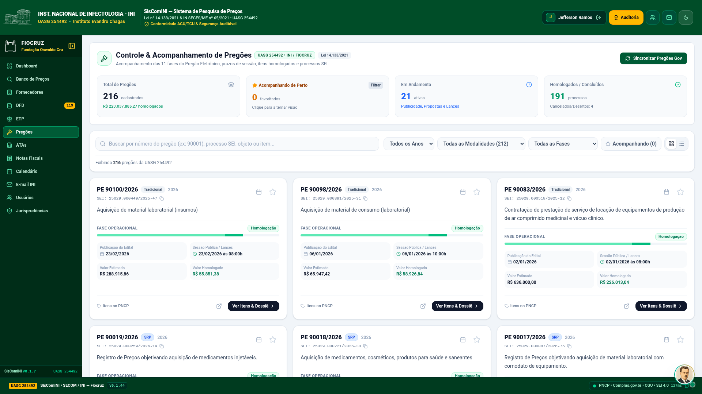
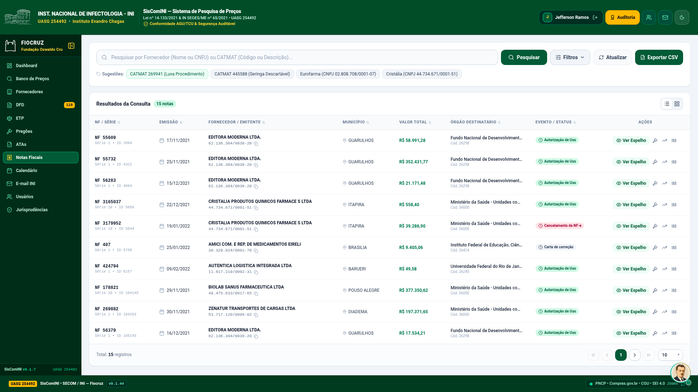

<div align="center">

# 🏛️ SisComINI
### **Plataforma GovTech de Inteligência em Licitações, Pesquisa de Preços e Automação Pública**
#### **Instituto Nacional de Infectologia Evandro Chagas (INI / Fiocruz) — UASG 254492**

[](https://workers.cloudflare.com/)
[](https://react.dev/)
[](https://www.typescriptlang.org/)
[](https://tailwindcss.com/)
[](https://ai.google.dev/)
[](#-o-problema-vs-a-solução-marco-legal-141332021)
[](#-nota-de-governança-segurança-e-compliance)
[](#-nota-de-governança-segurança-e-compliance)

<br/>

<p align="center">
  <b>Uma solução arquitetural de ponta para o setor público brasileiro: combinando computação de borda Serverless, interfaces generativas assistidas por IA (AI-UX / GenUI) e conformidade estrita com o novo marco regulatório das contratações públicas federais.</b>
</p>

</div>

---

## 🧭 Mapa de Navegação Executiva

<table align="center" width="100%">
  <tr>
    <td width="33%" align="center" valign="top">
      <a href="#-visão-geral--o-impacto">
        <br/><br/>
        <b>🌟 O Impacto</b>
      </a>
      <br/><br/>
      <sub>Transformação da burocracia em celeridade, eficiência de custos e apoio direto à saúde pública e à ciência.</sub>
    </td>
    <td width="33%" align="center" valign="top">
      <a href="#️-o-problema-vs-a-solução-marco-legal-141332021">
        <br/><br/>
        <b>⚖️ Problema vs. Solução</b>
      </a>
      <br/><br/>
      <sub>A nova Lei 14.133/2021, cesta de preços paramétrica, expurgo de sobrepreço e eliminação de riscos ao erário.</sub>
    </td>
    <td width="33%" align="center" valign="top">
      <a href="#️-arquitetura--engenharia-de-software">
        <br/><br/>
        <b>🏗️ Arquitetura & Borda</b>
      </a>
      <br/><br/>
      <sub>Cloudflare Workers Edge Serverless, agregador resiliente de APIs governamentais e ecossistema GenUI / AI-UX.</sub>
    </td>
  </tr>
  <tr>
    <td width="33%" align="center" valign="top">
      <a href="#️-galeria-de-interfaces--automação-showcase">
        <br/><br/>
        <b>🖼️ Telas & Demonstração</b>
      </a>
      <br/><br/>
      <sub>Galeria completa de capturas em 1080p e animação fluida (GIF) do fluxo operacional ponta a ponta.</sub>
    </td>
    <td width="33%" align="center" valign="top">
      <a href="#-nota-de-governança-segurança-e-compliance">
        <br/><br/>
        <b>🔒 Governança & LGPD</b>
      </a>
      <br/><br/>
      <sub>Diretrizes da Fiocruz, conformidade com a LGPD, padrões ISO/IEC 27001 e soberania de dados públicos.</sub>
    </td>
    <td width="33%" align="center" valign="top">
      <a href="#-liderança-técnica--engenharia">
        <br/><br/>
        <b>👨‍💻 Liderança & Contato</b>
      </a>
      <br/><br/>
      <sub>Visão de Engenharia de Software, competências aplicadas em GovTech e perfis de contato profissional.</sub>
    </td>
  </tr>
</table>

<details>
<summary><b>📑 Clique aqui para expandir o Índice Detalhado com subtópicos</b></summary>

<br/>

- **1. [Visão Geral & O Impacto](#-visão-geral--o-impacto)**
  - Aceleração Operacional Radical • Confiabilidade Matemática & Estatística • Rastreabilidade SEI • Impacto no SUS e na Ciência
- **2. [O Problema vs. A Solução (Marco Legal 14.133/2021)](#️-o-problema-vs-a-solução-marco-legal-141332021)**
  - Matriz comparativa: Formação da Cesta de Preços, Saneamento Paramétrico, Habilitação Unificada e Nota Técnica SEI
- **3. [Arquitetura & Engenharia de Software](#️-arquitetura--engenharia-de-software)**
  - [Cloudflare Workers & Borda Serverless](#1-borda-distribuída-serverless-cloudflare-workers)
  - [Estratégia de AI-UX & GenUI (Generative User Interface)](#2-inteligência-artificial-generativa-para-interfaces-ai-ux--genui)
  - [Diagrama de Arquitetura do Sistema (Mermaid)](#3-diagrama-de-arquitetura-do-sistema)
- **4. [Galeria de Interfaces & Automação (Showcase)](#️-galeria-de-interfaces--automação-showcase)**
  - [1. Painel Executivo Central de Contratações](#1-painel-executivo-central-de-contratações)
  - [2. Studio de Pesquisa de Preços & Copiloto Jurídico em IA (Dr. Evandrinho)](#2-studio-de-pesquisa-de-preços--copiloto-jurídico-em-ia-dr-evandrinho)
  - [3. Automação do Fluxo de Trabalho & Extração Federada (GIF Animado)](#3-automação-do-fluxo-de-trabalho--extração-federada)
  - [4. Raio-X do Fornecedor & Consulta Cadastral de Habilitação (SICAF)](#4-raio-x-do-fornecedor--consulta-cadastral-de-habilitação-sicaf)
  - [5. Controle e Acompanhamento de Pregões Eletrônicos (UASG 254492)](#5-controle-e-acompanhamento-de-pregões-eletrônicos-uasg-254492)
  - [6. Monitoramento de Notas Fiscais Eletrônicas (Transparência CGU)](#6-monitoramento-de-notas-fiscais-eletrônicas-transparência-cgu)
- **5. [Nota de Governança, Segurança e Compliance](#-nota-de-governança-segurança-e-compliance)**
- **6. [Liderança Técnica & Engenharia](#-liderança-técnica--engenharia)**

</details>

---

## 🌟 Visão Geral & O Impacto

O **SisComINI** é uma plataforma **GovTech** idealizada e construída para remodelar os processos de contratação e aquisição do **Setor de Compras (SECOM)** do **Instituto Nacional de Infectologia Evandro Chagas (INI / Fiocruz)** — órgão central de referência nacional para tratamento, ensino e pesquisas clínicas em doenças infecciosas no âmbito do SUS.

Na administração pública federal, a condução de processos licitatórios é regida por normas rigorosas e auditorias contínuas. Historicamente, servidores públicos despendem centenas de horas operacionais compilando orçamentos dispersos, recalculando médias em planilhas eletrônicas e redigindo peças processuais densas para os autos administrativos no SEI (Sistema Eletrônico de Informações).

O **SisComINI** substitui fluxos analógicos e fragmentados por um **ecossistema digital unificado de alta performance**, ancorado em três pilares essenciais:

1. **Aceleração Operacional Radical**: Redução do tempo médio de confecção da pesquisa de preços de **dias ou semanas** para **menos de 3 minutos**, com indexação automática por CATMAT/CATSER e extração direta de fontes oficiais.
2. **Confiabilidade Matemática & Estatística**: Aplicação de algoritmos de saneamento que calculam média, mediana, desvio padrão e **Coeficiente de Variação (CV%)**, expurgando cotações discrepantes e prevenindo riscos de sobrepreço ou inexequibilidade.
3. **Auditoria Contínua & Rastreabilidade**: Cada parâmetro de cálculo, amostra de compra pública e fundamentação legal possui rastreabilidade total, assegurando conformidade transparente perante a Controladoria-Geral da União (CGU) e o Tribunal de Contas da União (TCU).

> [!NOTE]
> **Impacto na Saúde e na Ciência**: A celeridade proporcionada pelo SisComINI nas compras públicas afeta diretamente a cadeia de suprimentos hospitalares do INI/Fiocruz, garantindo que insumos diagnósticos, medicamentos estratégicos e manutenções laboratoriais sejam contratados sem interrupções e com a máxima economicidade.

---

## ⚖️ O Problema vs. A Solução (Marco Legal 14.133/2021)

A entrada em vigor da **Nova Lei de Licitações e Contratos Administrativos (Lei nº 14.133/2021)** e da **Instrução Normativa SEGES/ME nº 65/2021** impôs padrões metodológicos muito mais exigentes para a formação da cesta de preços aceitável e a comprovação da regularidade dos fornecedores.

A tabela a seguir contrasta o paradigma operacional tradicional do setor público com a solução arquitetada no SisComINI:

| Dimensão Operacional | Paradigma Tradicional na Administração Pública | A Solução de Engenharia do SisComINI |
| :--- | :--- | :--- |
| **Pesquisa de Mercado (Art. 5º IN 65/2021)** | Servidores consultam múltiplos portais estatais isolados, baixam editais individualmente e preenchem planilhas manuais propensas a erro humano. | **Agregação Federada em Tempo Real**: Conexão unificada com PNCP e Compras.gov.br, recuperando cotações vigentes em segundos. |
| **Saneamento e Expurgo de Amostras** | Expurgo subjetivo ou inexistente, resultando em distorção de médias por valores desproporcionais e riscos de apontamento por sobrepreço. | **Motor Estatístico Algorítmico**: Filtro paramétrico automático de variação (mediana ±25%) e controle rigoroso de CV ≤ 25% para amostras homogêneas. |
| **Habilitação Cadastral de Fornecedores** | Abertura individual de 8 a 10 portais para emitir certidões negativas (SICAF, CND Federal, FGTS, CNDT, TCU, CNJ, CEIS, CNEP, etc.). | **Robô de Habilitação Unificado**: Varredura paralela em bases governamentais com consolidação em dossiê único e validação documental instantânea. |
| **Elaboração da Nota Técnica SEI** | Redação morosa, repetitiva e manual de relatórios técnicos, justificativas metodológicas e enquadramentos regulatórios. | **AI-UX em 2 Quadrantes (GenUI)**: Geração contextual dos 6 tópicos normativos padrão SEI via IA assistiva, permitindo conferência e edição individualizada antes da juntada. |
| **Transparência e Princípio da Legalidade** | Falta de clareza das fórmulas aplicadas em relatórios gerados por planilhas estáticas. | **Explicabilidade por Design**: Cada métrica possui indicador didático com a fórmula matemática exata e a fundamentação jurisprudencial expressa. |

---

## 🏗️ Arquitetura & Engenharia de Software

O SisComINI foi concebido a partir de princípios modernos de engenharia de software distribuída, priorizando **escalabilidade elástica**, **segurança no edge** e **experiência fluida para o servidor público**.

```
┌─────────────────────────────────────────────────────────────────────────────┐
│                                CLIENT LAYER                                 │
│          React 19 SPA • TypeScript • Tailwind CSS v4 • AI-UX Engine         │
└──────────────────────────────────────┬──────────────────────────────────────┘
                                       │ HTTPS / Encrypted Edge Stream
                                       ▼
┌─────────────────────────────────────────────────────────────────────────────┐
│                      EDGE SERVERLESS (Cloudflare Workers)                   │
│   • Global Low-Latency Routing           • Rate Limiting & Proxy Shield     │
│   • State Management & Edge Cache        • In-Memory Fast Aggregation       │
└──────────────────┬───────────────────────────────────────┬──────────────────┘
                   │                                       │
                   ▼                                       ▼
┌─────────────────────────────────────┐ ┌─────────────────────────────────────┐
│       INTELLIGENCE & AI LAYER       │ │     OFFICIAL GOV API FEDERATION     │
│  • Google Gemini Engine (GenUI)     │ │  • PNCP (Compras Públicas)          │
│  • Juridical Heuristics (TCU / AGU) │ │  • Compras.gov.br (Dados Abertos)   │
│  • Contextual SEI Drafting          │ │  • Portal da Transparência (CGU)    │
│  • Strict Truthfulness Engine       │ │  • Bases Federais (SICAF/RFB/TST)   │
└─────────────────────────────────────┘ └─────────────────────────────────────┘
```

### 1. Borda Distribuída Serverless (Cloudflare Workers)
- **Latência Global Próxima de Zero**: Toda a camada de roteamento, controle de sessão e proxies de API executa na rede edge da Cloudflare, garantindo que o servidor público acesse dados sem a latência típica de servidores legados centralizados.
- **Escudo de Resiliência para APIs Federais**: APIs de governo frequentemente sofrem picos de instabilidade. A camada de Workers atua como buffer inteligente, orquestrando requisições assíncronas, controle de taxa de requisições e normalização estruturada de dados.
- **Eficiência de Recursos e Governança**: Modelo Serverless de consumo sob demanda, mitigando custos com infraestrutura ociosa e mantendo padrão corporativo de alta disponibilidade.

### 2. Inteligência Artificial Generativa para Interfaces (AI-UX / GenUI)
Ao contrário de implementações convencionais de IA baseadas em chat genérico desacoplado, o SisComINI emprega **GenUI (Generative User Interface)**:
- **Componentes Vivos e Reativos**: O assistente especializado processa as variáveis do processo licitatório e projeta na tela componentes visuais nativos (tabelas de preços depuradas, alertas de dispersão estatística e minutas de documentos) perfeitamente integrados ao fluxo de trabalho.
- **Human-in-the-Loop Obrigatório**: A inteligência artificial assessora e sintetiza, mas o controle decisório permanece 100% nas mãos do servidor público, que pode calibrar parâmetros, editar minutas em tempo real e auditar cada citação.
- **Regra da Não-Alucinação (Dados Concretos)**: O motor de IA é estritamente instruído a consultar e citar apenas registros documentados nas bases oficiais, eliminando suposições ou dados artificiais.

### 3. Diagrama de Arquitetura do Sistema



---

## 🖼️ Galeria de Interfaces & Automação (Showcase)

> *Nota: Os registros demonstrados abaixo exibem cenários em ambiente de demonstração arquitetural, em consonância com a política de integridade de dados e proteção de processos em andamento.*

### 1. Painel Executivo Central de Contratações
Visão panorâmica em tempo real das pesquisas em elaboração, status de DFDs vinculadas ao Plano de Contratações Anual (PCA), métricas e indicadores de eficiência da UASG 254492.

<p align="center">
  
</p>

---

### 2. Studio de Pesquisa de Preços & Copiloto Jurídico em IA (Dr. Evandrinho)
Ambiente interativo de pesquisa federada com indexação por CATMAT, consulta com cálculo de Coeficiente de Variação (CV ≤ 25%) e assistente de IA jurídica contextual em tempo real.

<p align="center">
  
</p>

---

### 3. Automação do Fluxo de Trabalho & Extração Federada
Demonstração do fluxo operacional de ponta a ponta: do acesso institucional ao painel analítico da UASG, navegação por pesquisa federada de itens, suporte do assistente jurídico de IA (Dr. Evandrinho), consulta de fornecedores no SICAF e gestão de pregões.

<p align="center">
  
</p>

---

### 4. Raio-X do Fornecedor & Consulta Cadastral de Habilitação (SICAF)
Varredura de regularidade fiscal, jurídica e de sanções administrativas com emissão de certidões e histórico cadastral.

<p align="center">
  
</p>

---

### 5. Controle e Acompanhamento de Pregões Eletrônicos (UASG 254492)
Gestão das 11 fases do Pregão Eletrônico, controle de prazos de sessão, itens homologados, desertos, cancelados e integração com o PNCP.

<p align="center">
  
</p>

---

### 6. Monitoramento de Notas Fiscais Eletrônicas (Transparência CGU)
Consulta e cruzamento de NFe emitidas para a administração pública federal por chave de 44 dígitos, CNPJ ou CATMAT.

<p align="center">
  
</p>

---

## 🔒 Nota de Governança, Segurança e Compliance

> [!IMPORTANT]
> **Aviso de Portfólio & Vitrine Arquitetural (Showcase Edition)**  
> O presente repositório público foi estruturado estritamente como **demonstração de arquitetura de software, design de sistemas e competências de engenharia em GovTech**.
> 
> Em estrita observância à **Lei Geral de Proteção de Dados Pessoais (LGPD — Lei nº 13.709/2018)**, às diretrizes de soberania digital da **Fundação Oswaldo Cruz (Fiocruz / Ministério da Saúde)** e aos padrões normativos das normas **ABNT NBR ISO/IEC 27001 e 27002**:
> - O código-fonte integral de produção, regras internas proprietárias, segredos de ambiente, migrações de esquemas de banco de dados e rotinas internas de infraestrutura permanecem em **repositório privado e ambiente seguro homologado**.
> - Este portfólio não expõe dados confidenciais, PII de servidores ou licitantes, nem credenciais de acesso a sistemas estruturantes da Administração Pública Federal.

---

## 👨‍💻 Liderança Técnica & Engenharia

Projeto arquitetado e liderado com foco na convergência entre **Engenharia de Software Moderna**, **Inteligência Artificial Aplicada** e **Transformação Digital no Setor Público**.

- **Concepção Arquitetural**: Solução orientada a microsserviços na borda (Edge First), GenUI reativa e tipagem estrita de ponta a ponta.
- **Domínio de Negócio**: Especialização em compras governamentais, conformidade com a Lei 14.133/2021 e governança pública orientada a dados.
- **Portfólio / GitHub**: [@jeffezramos](https://github.com/jeffezramos)

---

<div align="center">
  <sub>SisComINI • Inteligência em Contratações Públicas • UASG 254492 • Fiocruz</sub>
</div>
